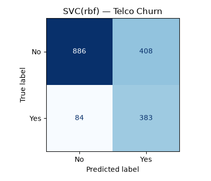
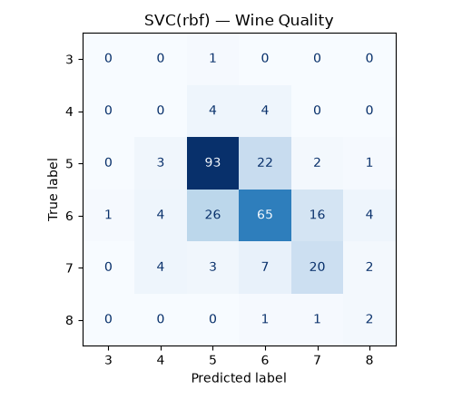
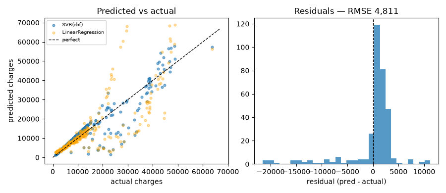

# Modeling SVM — 3 Dataset

Digenerate oleh `notebooks/02_svm.ipynb` (satu-satunya sumber tahap modeling).
Seluruh angka di bawah berasal dari satu run dengan `random_state=42`.

| Dataset | Tipe | Model | Metrik utama | Hasil |
|---|---|---|---|---|
| Telco Customer Churn | binary | SVC (rbf, `C=1`, `gamma=0.005`) | ROC-AUC | **0.8389** |
| Wine Quality | multiclass | SVC (rbf, `C=10`, `gamma=scale`) | macro-F1 | **0.3659** |
| Medical Cost | regression | SVR (rbf, `C=1000`, `gamma=0.01`, `eps=0.2`) | RMSE | **$4,811** |

---

## 1. Telco Customer Churn — binary classification

- Data: 7,043 baris, 19 fitur (drop `customerID`)
- Target: `Churn == 'Yes'` (26,5% positif — imbalance, jadi `class_weight='balanced'`)
- Preprocessing: `TotalCharges` kosong → 0 (semua baris `tenure=0`), kategorikal → one-hot, numerik → `StandardScaler`
- Split: 5282/1761 (stratified)
- Tuning: `GridSearchCV` 3-fold, scoring ROC-AUC → **CV ROC-AUC 0.8371**

| Metrik | Nilai |
|---|---|
| ROC-AUC | **0.8389** |
| PR-AUC | 0.635 |
| F1 (kelas `Yes`) | 0.6089 |
| Precision | 0.4842 |
| Recall | 0.8201 |

Confusion matrix (test set):

| actual \ pred | 0 | 1 |
|---|---|---|
| **0** | 886 | 408 |
| **1** | 84 | 383 |

Pembanding (baseline, tanpa tuning):

| Model | ROC-AUC | F1 |
|---|---|---|
| LogisticRegression | 0.8461 | 0.6284 |
| LinearSVC | 0.8439 | 0.6287 |

Jujur: baseline linear masih sedikit lebih tinggi di ROC-AUC (0.8461 vs 0.8389) dan F1. Ini normal untuk data tabular dengan banyak kolom one-hot — margin maksimal SVC paling berguna saat fitur sedikit tapi dimensinya tinggi/separable, bukan saat sinyalnya banyak yang lemah seperti churn. SVM tetap relevan di sini karena `class_weight` + `decision_function` memudahkan tuning threshold.

Recall 0.82 dengan precision 0.48: model sengaja diarahkan menangkap churn (FP lebih banyak ditoleransi). Kalau biaya retensi mahal, naikkan threshold sampai precision/recall seimbang.

---

## 2. Wine Quality — multiclass classification

- Data: 1,143 baris, 11 fitur (drop `Id`)
- Kelas: 3, 4, 5, 6, 7, 8 → `{3: 6, 4: 33, 5: 483, 6: 462, 7: 143, 8: 16}`
- Imbalance ekstrem: kelas 3 hanya 6 sampel, kelas 5+6 = 82,7% → `class_weight='balanced'`
- Multi-kelas: libsvm memecah jadi **one-vs-one** — 15 classifier biner antar-pasangan kelas (sklearn mengekspos `decision_function_shape='ovr'` untuk bentuk output, tapi training-nya tetap OVO)
- Split: 857/286 (stratified)
- Tuning: `GridSearchCV` 3-fold, scoring macro-F1 → **CV macro-F1 0.3016**

| Metrik | Nilai |
|---|---|
| macro-F1 | **0.3659** |
| weighted-F1 | 0.634 |
| accuracy (referensi saja) | 0.6294 |
| baseline tebak kelas mayoritas | 0.4231 |

Accuracy 0.6294 kelihatan oke, tapi baseline 'asal tebak kelas 6' sudah 0.4231 — itu sebabnya metrik utamanya macro-F1 (0.3659).

F1 per kelas:

| quality | F1 | support |
|---|---|---|
| 3 | 0.0 | 1 |
| 4 | 0.0 | 8 |
| 5 | 0.75 | 121 |
| 6 | 0.605 | 116 |
| 7 | 0.533 | 36 |
| 8 | 0.308 | 4 |

Confusion matrix (test set):

| actual \ pred | 3 | 4 | 5 | 6 | 7 | 8 |
|---|---|---|---|---|---|---|
| **3** | 0 | 0 | 1 | 0 | 0 | 0 |
| **4** | 0 | 0 | 4 | 4 | 0 | 0 |
| **5** | 0 | 3 | 93 | 22 | 2 | 1 |
| **6** | 1 | 4 | 26 | 65 | 16 | 4 |
| **7** | 0 | 4 | 3 | 7 | 20 | 2 |
| **8** | 0 | 0 | 0 | 1 | 1 | 2 |

Pembanding (baseline, fitur di-scale):

| Model | macro-F1 | accuracy |
|---|---|---|
| LogisticRegression | 0.2767 | 0.4371 |
| LinearSVC | 0.3118 | 0.5105 |
| **SVC (rbf, tuned)** | **0.3659** | 0.6294 |

Di dataset ini SVM jelas menang: batas keputusan non-linear (kimia wine) lebih cocok daripada hyperplane linear, dan `class_weight` membuat kelas 7/8 ikut terprediksi alih-alih ditelan kelas 5-6.

Catatan: kelas 3 (6 sampel) praktis tidak bisa diprediksi — 25% test set = ~1-2 sampel. Kalau target dianggap berurutan, **ordinal regression** lebih tepat daripada SVC, karena SVC memperlakukan 3 dan 8 sebagai kelas yang sama jauhnya.

---

## 3. Medical Cost (Insurance) — regression

- Data: 1,338 baris, 6 fitur (`age`, `bmi`, `children` numerik; `sex`, `smoker`, `region` kategorikal)
- Target: `charges` (skew 1,52) → **log1p(charges) lalu expm1 saat prediksi**
- Kenapa log: SVR meminimalkan error linear; tanpa log, RMSE didominasi segelintir pasien mahal (smoker + BMI tinggi)
- Split: 1003/335
- Tuning: `GridSearchCV` 3-fold, scoring -RMSE pada skala log → CV RMSE(log) 0.3686

| Model | RMSE | MAE | R² | MAPE |
|---|---|---|---|---|
| **SVR (rbf, tuned)** | **$4,811** | $2,806 | 0.8466 | 21.27% |
| LinearRegression (log target) | $7,751 | $3,951 | 0.6019 | 26.16% |

6.9% prediksi meleset > $10.000 — hampir semua di ekor kanan (perokok). Ini yang bikin R² regresi medis mentok di kisaran 0,8-0,9: `charges` punya komponen aturan (smoker × bmi × age) yang tidak sepenuhnya kontinu.

---

## Ringkasan

| Dataset | Model akhir | Metrik | Angka |
|---|---|---|---|
| Telco | `SVC(kernel='rbf', C=1, gamma=0.005, class_weight='balanced')` | ROC-AUC | 0.8389 |
| Wine | `SVC(kernel='rbf', C=10, gamma=scale, class_weight='balanced')` | macro-F1 | 0.3659 |
| Insurance | `SVR(kernel='rbf', C=1000, gamma=0.01, epsilon=0.2)` + log target | RMSE | $4,811 |

Waktu jalan (notebook): Telco 22.6s, Wine 0.3s, Insurance 14.0s

